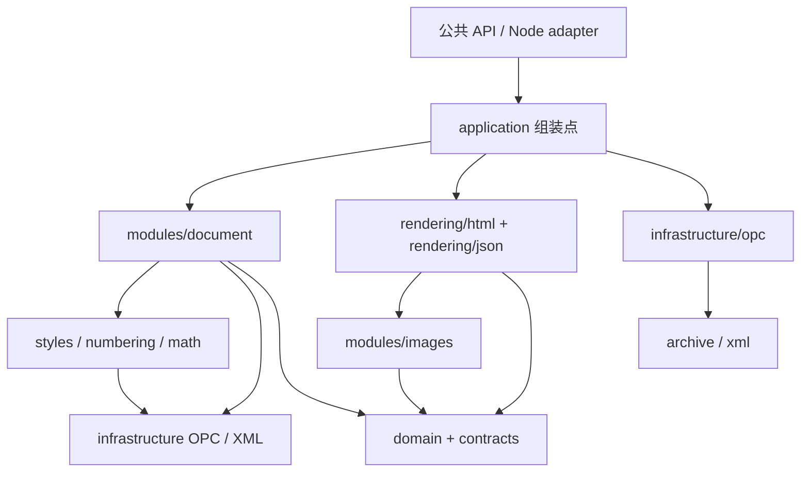

# 模块架构与 Java 参考项目对照

技术路线 B：独立 TypeScript OOXML 转换器。输出目标是保留支持范围内的文档结构和格式，而非复刻 Word 的分页排版。

## 组织原则与目录

采用**单 npm 包、按职责分层、层内按文档能力分模块**的组织方式。`apps/playground` 是同仓库的演示应用，不是第二个 npm 包。公共导出由 `src/index.ts`、`src/node.ts` 和 `src/browser-metafile.ts` 管理；内部模块直接导入明确的文件，不通过公共入口绕行。

```text
src/
├── index.ts                     浏览器 / Node 通用公共 API
├── node.ts                      Node 文件路径公共 API：convertToHtmlFile / convertToJsonFile
├── browser-metafile.ts          浏览器 WMF/EMF 图片适配器公共 API
├── contracts/                   转换参数、结果、错误和内部端口
├── domain/document.ts           HTML / JSON 共用的段落、表格、文本、图片、公式模型
├── application/                 转换流程、单次会话、输入归一化、限制
├── infrastructure/
│   ├── archive/                 ZIP 解压和体积约束
│   ├── opc/                     包关系、Content Types、部件读取接口
│   └── xml/                     安全 XML 解析、命名空间和 DOM 遍历
├── modules/
│   ├── document/                正文编排、段落、行内、绘图、表格解析
│   ├── styles/                  字体、主题、样式继承、OOXML 尺寸值
│   ├── numbering/               编号定义
│   ├── math/                    OMML → 内部 MathML / LaTeX；OLE CFB → MTEF → LaTeX；WMF 一致性检查
│   └── images/                  位图识别、EMF 转 PNG、转换策略、资源地址解析
├── rendering/html/              HTML、CSS、列表、图注表注、图片展示
├── rendering/json/              文档模型的 JSON 安全投影与图片地址解析
├── rendering/math-image-source.ts HTML / JSON 共用的 OMML SVG 数据源
├── adapters/
│   ├── browser/                  WMF/EMF → PNG 图片适配器
│   └── node/                     文件读取与显式启用的 ImageMagick 适配器
└── shared/                      无状态的转义、URL 校验和单位工具
apps/playground/
├── main.ts                      组装页面组件
├── controller.ts                文件 / 示例转换流程、结果、请求竞争处理
├── ui/view.ts                   DOM、状态、标签页、统计与诊断展示
├── worker/                      类型化消息协议、Worker 入口和生命周期
├── downloads.ts                 HTML / JSON / ZIP 导出（原始资源与生成的 PNG）
└── styles.css                   应用样式
tests/
├── fixtures/                    最小 DOCX 构造器
├── unit/                        模块边界、会话隔离、Worker 生命周期
├── integration/                 公共转换 API 的能力与错误场景
└── e2e/                         浏览器预览、导出、UMD、响应式与请求竞争
scripts/                         架构检查、示例文档生成
```

`contracts/conversion.ts` 是公开转换参数和 HTML 结果 DTO；JSON 结果及文档模型类型也从包主入口导出。`contracts/ports.ts` 是内部协作接口，不作为插件 API 导出。`domain` 包含 CSS 属性和受控 MathML，是 HTML 与 JSON 共用、保留当前转换能力的文档模型，不宣称为完全与格式无关的通用文档模型。`shared` 仅接收多个模块确实共用且不带状态的函数。

## 转换链路与状态归属

```text
File / Blob / ArrayBuffer / Uint8Array
  → application/convert-docx.ts  唯一转换组装点，创建 ConversionSession
  → archive → DocxPackage      解压限制 → OPC 关系、XML 缓存
  → DocumentParser             协调段落 / 行内 / 绘图 / 表格解析
  → ParsedDocument             内容模型、统计、被引用资源路径
  → HtmlRenderer / JsonRenderer 仅消费同一个模型、ResourceReader、RenderContext
  → ImageResolver              images.convert → 按大小选择 processLargeImage / resolve / Base64
  → ConversionResult / JsonConversionResult
```

解析器使用 namespace URI + localName，避免依赖 XML 前缀。主文档和辅助部件通过 OPC relationships 定位。包内路径归一化并拒绝越界，不自动访问外部关系。`@xmldom/xmldom` 提供浏览器、Worker、Node 一致的 XML API。

每次 `convertToHtml` 或 `convertToJson` 创建独立的包缓存、解析上下文、会话和输出渲染器。两者通过同一个 `parseDocx` 流程取得 `DocumentModel`，然后分别投影为 HTML 或可序列化的 JSON 树。`ConversionSession` 负责取消、进度及诊断；`ParseContext` 负责本次解析的样式、编号、统计和资源集合；列表计数器属于本次 HTML 渲染器。没有全局可变转换状态，不跨请求共享缓存。

`DocumentParser` 通过回调连接“表格中解析块”和“文本框中解析段落”的递归关系，子解析器无需反向引用主解析器。渲染器仅要求 `ResourceReader` 提供资源字节和 MIME，不访问 XML、不持有 `DocumentParser`。因此可以使用手写模型和内存资源直接测试渲染。

## 依赖边界



箭头表示允许的依赖方向，通用 `shared` 依赖省略。具体规则由 `scripts/check-architecture.ts` 执行：

- `contracts`、`domain`、`shared` 各自独立，不依赖其他层或外部包。
- `infrastructure` 仅依赖本层、contracts/domain/shared；不依赖文档业务模块。
- `modules/document` 可协调 styles、numbering、math；能力模块不反向引用 document，也不引用 application/rendering。
- `modules/images` 通过资源接口工作，不依赖 OPC/XML。
- `rendering` 可依赖 images、domain/contracts/shared，不依赖解析器或 infrastructure。
- `application` 负责组装具体实现；Node 适配器调用 application，不能被其反向引用。
- 演示应用访问库时只导入 `src/index.ts` 和公开的 `src/browser-metafile.ts`，不直接调用内部模块。
- `node:*` 及 Node 内置模块只能出现在 `src/adapters/node`。所有源码中的静态导入、重导出、类型导入、字面量动态导入及 Worker URL 都纳入依赖图和循环检查；非字面量模块加载被拒绝。

这是源码工程约束，不是运行时沙箱，也不会分析第三方包内部依赖。浏览器入口仍需通过实际 Vite 构建和浏览器测试验证。

## 设计模式的具体用途

| 模式 / 原则 | 落点 | 解决的问题 |
| --- | --- | --- |
| Facade 外观 | index.ts / node.ts | npm 使用者不需要了解内部目录，内部重构不改变调用方式 |
| Pipeline 流程编排 | application/convert-docx.ts | 明确输入、解压、解析、渲染、资源收集的顺序与失败边界 |
| Strategy 策略 | images.convert / images.processLargeImage / images.resolve | 由调用方选择格式转换、按大小上传和 URL 生成，支持异步 |
| Adapter 适配器 | Node 文件入口、Worker 客户端 / 入口 | 文件系统、线程和消息差异留在环境边界 |
| 依赖倒置 | ResourceReader / DiagnosticSink / RenderContext | 渲染不再依赖解析器实例；诊断不靠共享裸数组传递 |
| Composite 组合结构 | DocumentModel 的 Block / Inline | 段落、单元格、嵌套表格及行内链接递归处理 |
| Controller / View 分离 | playground/controller.ts / ui/view.ts | 转换和请求竞争处理与 DOM 展示分开 |

类用于有生命周期的状态对象；纯变换保留函数。采用显式构造参数与回调注入，不引入 DI 容器、服务定位器、全局事件总线或每层一套工厂。当前模块没有独立版本与发布需求，保留单包有利于统一构建和回归；未来只有在 API 和发布周期真正独立时才拆包。

浏览器 `ConversionWorkerClient` 管理一项任务，成功、失败、超时和取消都会清理定时器、终止 Worker 并结算 Promise。控制器使用递增请求标识，旧示例下载、旧文件读取及旧 Worker 结果不能覆盖新请求。转换协议使用可辨识联合类型，主页面和 Worker 分别通过 DOM / WebWorker TypeScript 配置校验。

View 在预览标签页可见时挂载新的 sandbox iframe；源码标签页下产生的结果延迟到切回预览时挂载。这样避免隐藏 iframe 连续加载空 srcdoc 和转换结果时出现的零尺寸布局，同时保持每份结果的预览文档独立。

## 主要设计

1. **样式解析**：docDefaults → 段落样式 basedOn 链 → 字符样式 → 直接属性。缺失值与 false 区分；主题引用转换为实际字体/颜色。`RunStyle` 中保留中文/西文字体，渲染时按 Unicode 字符类别拆分。
2. **表格网格**：直接遍历 tr/tc，维护逻辑列位置及上一行的纵向合并起点。合并宽度匹配时更新 rowspan，最后按完整合并区域计算外框/内框。单元格明确 none/nil 优先。嵌套表格独立解析。单元格 `w:shd` 的 `w:fill="auto"` 不生成黑色背景；明确的十六进制填充和 `w:themeFill` 分别解析，避免混用图案颜色 `w:themeColor`。
3. **公式**：OMML 递归生成内部 MathML，并同步重建 LaTeX；HTML 渲染器默认用 MathJax 将内部 MathML 转成字形路径内嵌的 SVG，再作为 `data:` 图片输出。字形取自 STIX Two Math，以贴近 Word OMML 默认的 Cambria Math（后者为专有字体，MathJax 不能分发，因此只能近似）。段落字号由外层 HTML 继承，不重复传入 SVG 排版；独立 SVG 的 viewBox 留有字形外溢余量，避免图片裁切。显式设置 `formulaOutput: 'mathml'` 可保留语义标记。旧版 OLE 公式按包内关系读取，不执行对象；有界 CFB 读取器只取 `Equation Native` 流，MTEF 3/5 解析器保守重建 LaTeX，再检查 WMF 标准字体数字是否与预览明显冲突。结果附在对应图片的 `data-latex`；解析失败或冲突时保留图片，省略属性。OMML 遇到不支持结构时也省略不可靠的 LaTeX。
4. **图片**：原始资源永远可回收；能识别的位图可直接嵌入。普通 EMF 在默认路径按需加载 `emf-converter` 转成 PNG，自定义 `imageHandler.convert` 优先；WMF 等其他格式仍可用 convert 适配器，地址处理交给 resolve。浏览器演示应用使用同一转换器处理普通 WMF/EMF 及公式预览；Node 入口还导出显式启用的 ImageMagick 公式预览适配器。失败时沿用占位及诊断。
5. **后处理**：在结构模型渲染中识别相邻图注与表注；合并相邻同样式文本，不使用按序号对齐原始 Word 和 HTML 的补丁。
6. **环境隔离**：主入口无 Node 内置模块；Node 路径入口单独导出。网页在 Worker 中调用同一个主入口，取消时终止 Worker。npm 调用方自行选择执行环境。

## 与 Java 版本的关系

| Java 概念 | TypeScript 实现 |
| --- | --- |
| DocxConverter / ConversionConfig | convertToHtml / ConversionOptions |
| DocxExtractor / ExtractedDocx | 内存 DocxPackage，无临时解压目录 |
| StylesParser / ThemeParser | Styles |
| NumberingParser | Numbering，读取各级编号 |
| DocumentParser / 模型类 | DocumentParser / discriminated unions |
| OmmlToMathmlConverter / OmmlToLatexConverter | modules/math/omml-converter.ts，同步生成两种表达 |
| ImageUriResolver | ImageResolver 按阈值调用 images.processLargeImage；images.resolve 保留全量自定义地址能力 |
| WmfRasterizer | EMF 内置 `emf-converter`；WMF 可用 `browser-metafile` 或 Node ImageMagick 适配器 |
| OleEquationLatex / MtefLatexConverter | modules/math/ole-native-stream.ts、ole-equation.ts、mtef-latex.ts |
| FormulaPreviewConsistency | modules/math/preview-consistency.ts |
| HtmlRenderer / StyleMapper | HtmlRenderer / textCss |
| FigureCaptionProcessor / TableCaptionProcessor | 渲染相邻结构时生成 figure/caption |
| AdjacentSpanProcessor | 合并连续且有效样式相同的文本片段 |

保留规则而非逐行翻译。Java 的外部进程、POI/Java2D、OSS 生命周期不进入浏览器内核。当前 OLE/MTEF、矢量图片与图形能力没有宣称与 Java 等价，详见 README 支持矩阵。

## 后续适配边界

- MTEF 的更多模板、符号字体和复杂数学排版需要独立验证；不能把图片 OCR 猜测当作准确 LaTeX。当前 WMF 数字核对只能发现一部分明显冲突，并非公式等价性证明。
- 普通 EMF 默认转 PNG；WMF/EMF 也可通过现有 images.convert 接口在浏览器转成 PNG，或在 Node 显式启用 ImageMagick 公式预览适配器。图片先转换成可显示字节，再按 base64ImageSize 判断是否调用 processLargeImage；未提供回调时保持 Base64。默认核心库不会上传文件或启动本地进程。
- DrawingML 图形需要新增模型与 SVG 几何渲染；不能直接插入来源文档的任意 SVG/HTML。
- 若需要语义化内容导入，可新增 Mammoth adapter，但不依赖其内部 AST，也不以它补写格式后的输出作为样式保真模式。

## 验收

字体与样式值、标题规则、表格结构、公式 SVG/MathML/LaTeX、资源保存通过集成测试验证。模块测试覆盖独立渲染、会话隔离和 Worker 清理；浏览器验收覆盖 Worker、预览、HTML 下载、重新打开、普通 script 调用、小屏布局和旧请求覆盖保护。现有 Java demo 仅用于本地对照检查，不纳入 npm 包。

`npm run check` 运行依赖约束、四组 TypeScript 校验及 Vitest；`npm run build` 也会校验架构和类型。完整验收执行 `npm run verify`。新增功能的文件归属、检查命令与提交范围见 [贡献指南](../CONTRIBUTING.md)。
